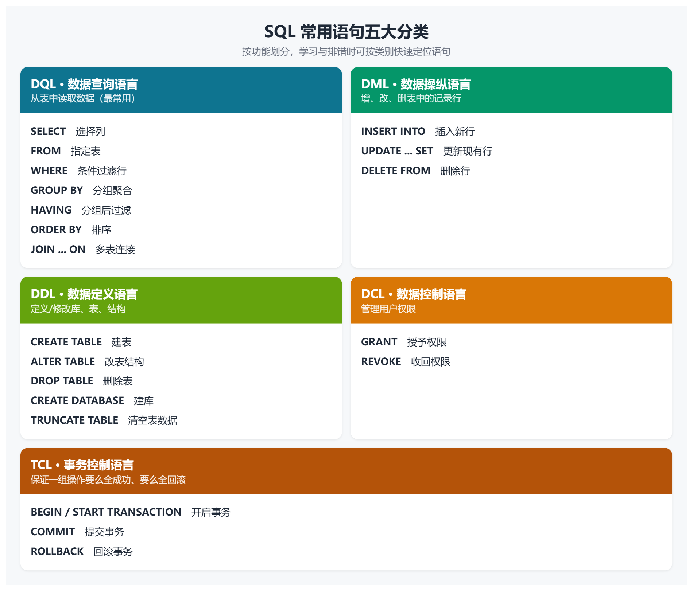
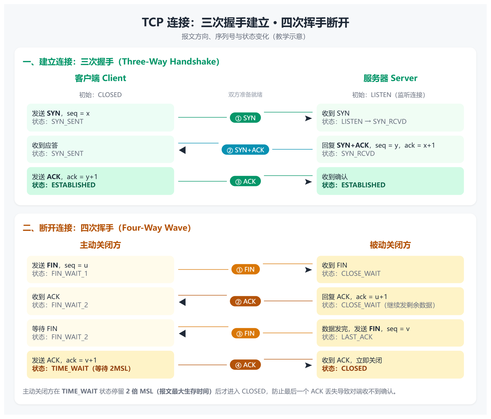
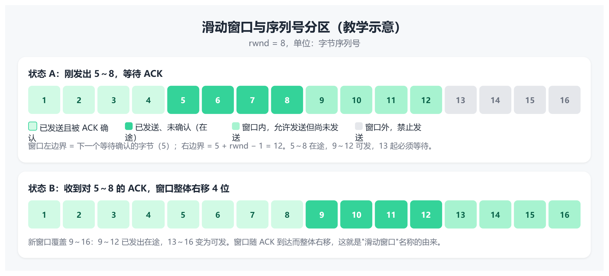
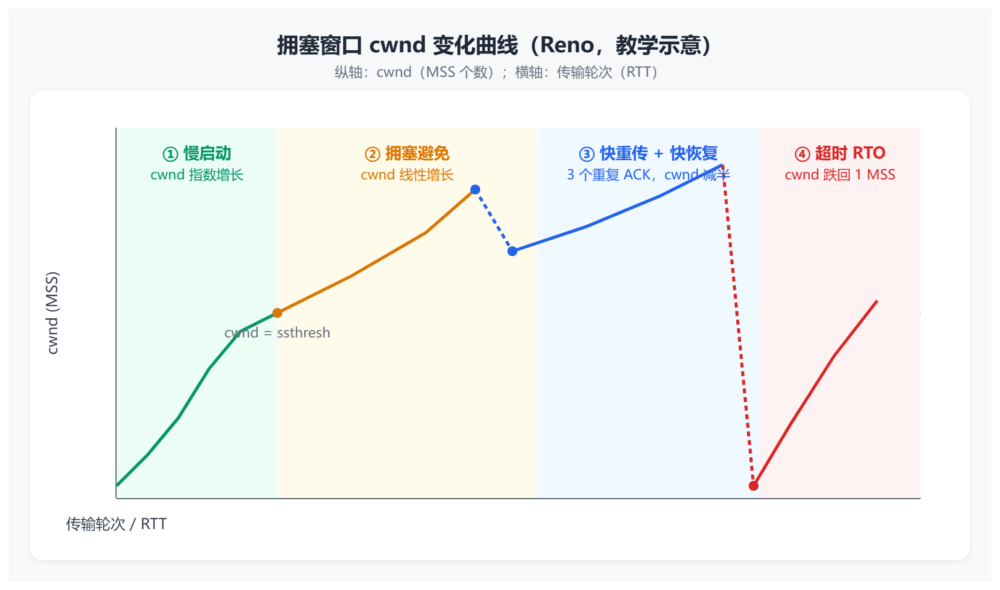
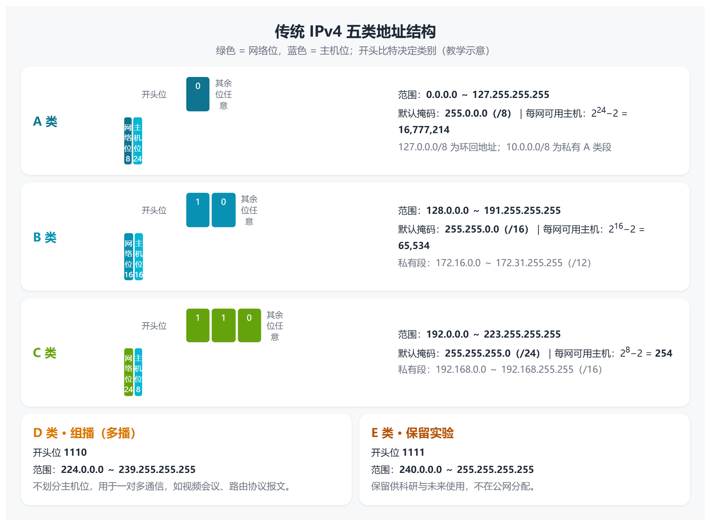
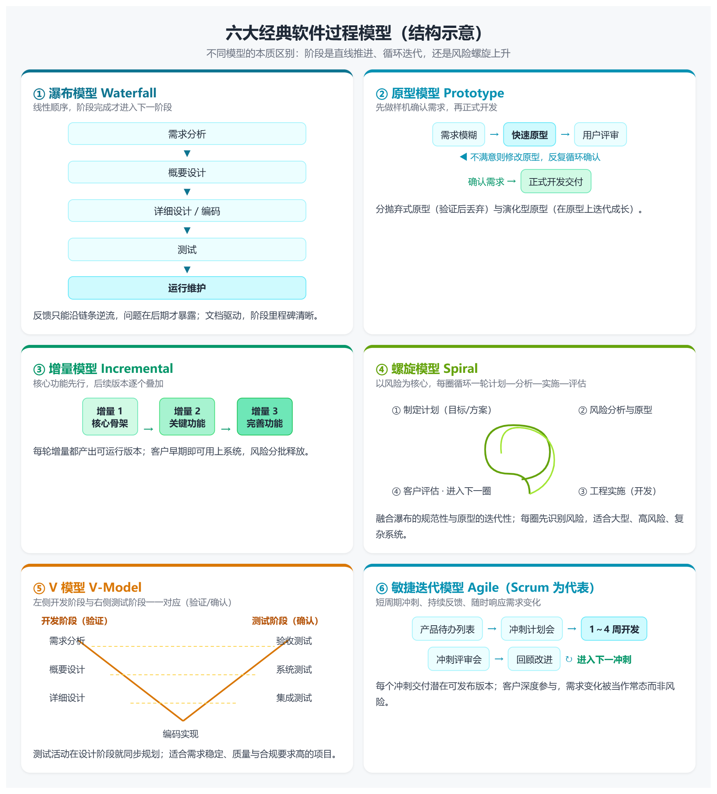
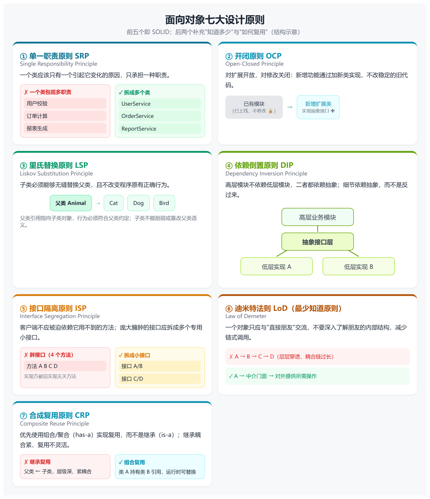

## 数据结构

### 复杂度分析

**逻辑结构**：集合，线性结构，树形结构，图形结构。**存储结构**：顺序存储，链式存储，索引存储，散列存储。

### 循环队列

假设循环队列Q的容量为M，队头指针f指向第一个元素，队尾指针r指向最后一个元素的下一位。则当f=r时，队列为空；             当(r+1)%M=f时，队列已满。队列中元素的个数可表示位(r-f+M)%M。

### 树与二叉树

#### 二叉树性质

- 叶子节点=度为2的节点+1
- 第i层节点最多有$2^{i-1}$个节点
- 高度为h的二叉树最多有$2^h-1$个节点
- n个节点的完全二叉树高度为$\lfloor log_2n\rfloor+1$
- 完全二叉树按层编号：左孩子$2i$，右孩子$2i+1$，父节点$\lfloor i/2\rfloor$

#### 二叉树遍历

**前序遍历：**根左右。**后序遍历：**左右根。**中序遍历：**左根右。

#### 哈夫曼树

- 构造：每次取两个最小权值合并，新结点权值为两者之和，放回集合重复
- n 个叶子的哈夫曼树共 **2n−1** 个结点，没有度为 1 的结点
- 哈夫曼编码是**前缀码**，左 0 右 1（或相反），使总码长最短

#### B树，B+树，红黑树

- **B 树**：多路平衡，结点即磁盘块，全树存关键字，适合**随机单点查找**
- **B+ 树**：非叶只做索引、全关键字在叶子并串成链表，适合**范围查询和顺序扫描**（数据库索引标配）
- **红黑树**：二叉 + 颜色约束实现的近似平衡，适合**内存中频繁增删**

### 排序

- **稳定**（排序前后相同元素的相对位置不变）：插入排序，冒泡排序，归并排序，基数排序
- **不稳定**：希尔排序，快速排序，选择排序，堆排序
- 平均时间复杂度$O(n^2)$：插入排序，选择排序，冒泡排序（都是元素两两比较）。其中插入排序与冒泡排序的最好时间复杂度（元素有序）为$O(n)$，最差为$O(n^2)$。选择排序的最好和最坏时间复杂度为$O(n^2)$。
- 平均时间复杂度$O(nlogn)$：快速排序，堆排序，归并排序。其中快速排序的最坏复杂度为$O(n^2)$，空间复杂度为$O(logn)$。归并排序的空间复杂度为$O(n)$。
- 希尔排序的平均时间复杂度$O(n^{1.3})$，最坏时间复杂度$O(n^2)$。
- 时间复杂度与初始序列有关的排序：插入排序，希尔排序，冒泡排序，快速排序。
- 一趟排序就能确定元素最终位置：冒泡排序，选择排序，快速排序，堆排序。

## 操作系统

### 操作系统的四大特征

- **并发**（多个程序在同一时间内间隔交替执行，微观串行，宏观并行）
- **共享**（系统的资源能被多个进程使用）
- **虚拟**（通过抽象和模拟物理资源，为用户和程序提供比实际硬件更多的资源感知）
- **异步**（事件的发生和处理不必同步进行，操作系统在等待某些操作完成时继续执行其他任务）

### 内核态和用户态

- 用户态到内核态只能通过中断或异常，不能由程序直接跳转。
- 中断来自外部事件（I/O完成，时钟），异常来自内部事件（缺页，除零，越界，系统调用）。

### 进程和线程

- **进程 = 程序段 + 数据段 + PCB**。PCB 是进程存在的唯一标志，内含 PID、状态、程序计数器、寄存器现场、优先级、资源清单、内存指针。进程的**基本特征是动态性**（程序是静态的）。
- **进程状态转换**

​	**一条进程的顺利运行**：首先新建进程，新建完成后处于就绪态，有OS调度在CPU运行，进程运行结束后终止。						  	**新建态 ——> 就绪态 ——> 运行态 ——> 终止态**

​	**进程需要执行I/O请求**：首先被安排到阻塞态，I/O操作完成后，再有阻塞态切换为就绪态。**运行态 ——> 阻塞态 ——> 就绪态**

​	**进程时间片结束或被抢占**：**运行态 ——> 就绪态**

### 调度算法

- **FCFS先来先服务**：谁先到达就绪队列，谁先获得CPU，一旦获得CPU会一直运行到终止或阻塞。对长作业有利，对短作业不利，非抢占式。
- **SJF短作业优先**：优先调度运行时间短的作业，可能导致长作业饥饿，抢占式。
- **GRRN高响应比优先**：响应比 = （等待时间 + 服务时间）/ 服务时间。用于避免长作业的长时间等待，同时减少短作业的周转时间，非抢占式。
- **优先级调度**：根据进程的优先级分配CPU，分为非抢占式（实现简单但可能导致低优先级作业饥饿）和抢占式（响应迅速但进程切换频繁增加开销）
- **时间片轮转**：将CPU时间划分为固定的时间片，将所有就绪进程按先来先服务排成循环队列，时间片过短，进程频繁切换增加开销，过长则退化为先来先服务，抢占式。
- **多级反馈队列**：结合了优先级调度和时间片轮转，通过设置多个优先级递减、时间片递增的队列，使短作业快速完成、交互型任务响应更快，长作业时间片用尽时降级到更低优先级队列。队列内部采用先来先服务的时间片轮转调度，高优先级队列有新任务时抢占低优先级队列任务。

​		**优点**：短作业优先，通过高优先级短时间片实现近似 SJF。交互型任务响应快，频繁 I/O 的任务保持高优先级。无需预知作业		长度，通过历史行为动态调整优先级。

​		**缺点**：可能出现饥饿，大量高优先级任务会使低优先级任务长期得不到 CPU。可能被“欺骗”，进程若频繁主动放弃 CPU，可		保持高优先级。

​		**应用场景**：UNIX/Linux 等现代操作系统默认使用或借鉴 MLFQ。适用于交互型系统、分时系统、需要兼顾响应时间与周转时		间的场景。

### 死锁

- **死锁的四个必要条件**：**互斥**（资源一次只能被一个进程占用）。**不可剥夺**（已获得的资源不能被强行抢走）。**请求并保持**（占有资源的同时又申请新资源）。**循环等待**（存在进程—资源的环形等待链）。
- **处理死锁的四种策略**：**预防死锁**（破坏四个必要条件之一。运行中逐步释放已用完的资源；当进程申请资源失败必须释放已有资源重新申请；一次性分配所有资源；资源有序分配）。**避免死锁**（银行家算法，每次分配前判断是否处于安全状态）。**检测**（资源分配图化简，能消去所有边则无死锁；消不掉则死锁）。**解除**（终止进程，剥夺资源，回退。按代价最小原则选择牺牲者 ）

### 页面置换算法

- **最佳置换算法OPT**：淘汰未来最久不用的页，无法实现，只作评价基准，缺页最少
- **先进先出算法FIFO**：通过淘汰最早进入内存的页面来调入新页面，由于算法只考虑页面进入时间，不考虑访问频率，可能导致频繁缺页
- **最近最久未使用LRU**：在内存已满且需要置换页面时，选择最久没有被访问的页面进行替换，系统的开销比较大
- **时钟页面置换算法CLOCK**：LRU的近视，对FIFO的一种改进。当页面被装入内存时设置初始访问位0，把各个页面组织形成环形链表，把指针指向最先进来的页面。当发生一个缺页中断时，考察指针所指向的最老页面。若它的访问位为0，立即淘汰；若访问位为1，则把该位置为0，然后指针往下移动一格。
- **抖动现象**：分配给进程的页框太少，刚换出的页立刻又要用，系统把大量时间花在换页上，缺页率急剧上升、CPU 利用率反而下降。解决思路：使用常驻集与工作集结合局部置换策略（置换页面的选择范围仅限于当前进程所占用的物理内存页面，而不涉及其他进程的页面）、挂起部分进程。
- **位示图**：`字号 = 块号 ÷ 字长`，`位号 = 块号 % 字长`

### 磁盘调度算法

**访问时间 = 寻道时间 + 旋转延迟 + 传输时间**

- **先来先服务调度FCFS**：按请求顺序，公平但效率低。
- **最近优先SSTF**：平均寻道最短，但可能饥饿
- **SCAN电梯**：从磁盘的一端扫到另一端，沿途处理所有请求，到达边界后反向移动
- **C-SCAN**：单向扫描到边界后然后回到起点

### 设备管理

- **程序直接控制**：CPU通过轮询设备状态来直接管理数据传输，CPU利用率低但实现简单。数据单位：字节/字
- **中断驱动**：当CPU向设备控制器发出I/O命令后，不必等待设备完成操作，而是继续执行其他任务；设备完成操作后，通过中断信号通知CPU，CPU暂停当前程序，保存现场，然后执行中断处理程序，处理完毕后恢复原程序继续执行。数据单位：字节/字
- **DMA**：外设发出 DMA 请求，DMA 控制器向 CPU 请求总线控制权，CPU 授权并释放总线，DMA 控制器执行数据传输（外设↔内存 / 内存↔内存），传输完成后通知 CPU 并释放总线。数据单位：数据块
- **通道**：通道程序是由一系列“通道命令字（CCW）”组成、由通道处理机独立执行的 I/O 控制程序，用于在主存与外设之间自动完成数据传输，显著减轻 CPU 的 I/O 负担。 它存放在主存中，由 CPU 通过启动 I/O 指令触发，随后由通道自主执行，实现 CPU 与 I/O 的并行工作 。数据单位：一组块

## 数据库

### 三级模式与两级映像

数据库的三级模式包括外模式（用户视图）、概念模式（全局逻辑结构）和内模式（物理存储结构），它们共同实现数据库的逻辑独立性与物理独立性。

- **外模式**：面向用户或应用程序的局部数据视图，是用户能看到和使用的数据逻辑结构。一个数据库可以有多个外模式。
- **概念模式**：数据库的全局逻辑结构，是所有用户的公共数据视图，一个数据库只有一个概念模式。
- **内模式**：描述数据的物理存储方式，包括记录组织、索引结构、压缩与加密等，一个数据库只有一个内模式。

**外模式**面向用户，独立于内模式和存储设备。**概念模式**作为中间层，连接外模式与内模式。**内模式**面向物理存储，独立于外模式。

三级模式通过**两级映像**实现数据独立性。**外模式/概念模式映像**：保证逻辑独立性。当概念模式改变时，只需调整映像即可保持外模式不变。**概念模式/内模式映像**：保证物理独立性。当物理存储改变时，通过调整映像保持概念模式不变。

### 基本术语

**关系**：表。**元组**：行，记录。**属性**：列，字段。**域**：列的取值范围。

#### 码的层级

- **超码**：超码是数据库中用于唯一标识记录的属性集合，可以含多余属性。
- **候选码**：最小的超码，去掉任何一个属性都不能唯一标识，一个关系可以有多个候选码。
- **主码**：从候选码中人为选定的一个，只有一个。
- **主属性**：包含在任何一个候选码中的属性；其余为非主属性。注意是"任一候选码"，不是"主码"——这是范式判定的关键。
- **外码**：本关系的属性，是另一个关系的主码（也可以是本关系的主码，即自参照）。

#### 完整性约束

- **实体完整性**：要求表中每行必须能被唯一标识，主键不能为 NULL 且必须唯一，保证实体可区分。
- **域完整性**：限制字段的取值范围、数据类型、精度、是否允许为空等，确保字段值有效且符合语义。
- **参照完整性**：保证表间引用关系正确，外键值必须为 NULL 或引用另一表的主键值。
- **用户定义完整性**：针对具体业务规则的约束，如年龄范围、工资不能减少等。

### 基本运算

**Student**（学生）

| Sno  | Sname | Sdept  | Sage |
| :--- | :---- | :----- | :--- |
| S1   | 张三  | 计算机 | 20   |
| S2   | 李四  | 数学   | 19   |
| S3   | 王五  | 计算机 | 21   |
| S4   | 赵六  | 数学   | 22   |

**SC**（选课）

| Sno  | Cno  | Grade |
| :--- | :--- | :---- |
| S1   | C1   | 90    |
| S1   | C2   | 85    |
| S2   | C1   | 78    |
| S3   | C1   | 92    |
| S3   | C2   | 88    |

**Course**（课程）

| Cno  | Cname    |
| :--- | :------- |
| C1   | 数据库   |
| C2   | 操作系统 |

#### 关系运算

- **选择** $\sigma条件(r)$：$\sigma_{Sage>20}(Student)$

| Sno  | Sname | Sdept  | Sage |
| :--- | :---- | :----- | :--- |
| S1   | 张三  | 计算机 | 20   |
| S3   | 王五  | 计算机 | 21   |

- **投影** $\pi条件(r)$：$\pi_{Sdept}(Student)$（投影会自动去重）

| Sdept  |
| :----- |
| 计算机 |
| 数学   |

- **自然连接** $Student\Join SC$：自然连接自动根据同名列进行连接，并在结果集中去除重复列

| Sno  | Sname | Sdept  | Sage | Cno  | Grade |
| :--- | :---- | :----- | :--- | :--- | :---- |
| S1   | 张三  | 计算机 | 20   | C1   | 90    |
| S1   | 张三  | 计算机 | 20   | C2   | 85    |
| S2   | 李四  | 数学   | 19   | C1   | 78    |
| S3   | 王五  | 计算机 | 21   | C1   | 92    |
| S3   | 王五  | 计算机 | 21   | C2   | 88    |

- **等值连接** $Student\Join_{Student.Sno=SC.Sno} SC$：等值连接基于指定条件（=，>,<等）将两个表连接起来，返回所有满足条件的行，包括重复列

| Student.Sno | Sname | Sdept  | Sage | SC.Sno | Cno  | Grade |
| :---------- | :---- | :----- | :--- | :----- | :--- | :---- |
| S1          | 张三  | 计算机 | 20   | S1     | C1   | 90    |
| S1          | 张三  | 计算机 | 20   | S1     | C2   | 85    |
| S2          | 李四  | 数学   | 19   | S2     | C1   | 78    |
| S3          | 王五  | 计算机 | 21   | S3     | C1   | 92    |
| S3          | 王五  | 计算机 | 21   | S3     | C2   | 88    |

- **除**：SC 里同时有 Sno 和 Cno，Course 里只有 Cno。两者做除法，意思是找出选修了 Course 中全部课程的学生。

被除表$\pi_{Sno,Cno}(SC)$

| Sno  | Cno  |
| :--- | :--- |
| S1   | C1   |
| S1   | C2   |
| S2   | C1   |
| S3   | C1   |
| S3   | C2   |

除数 $\pi_{Cno}(Course)$

| Cno  |
| :--- |
| C1   |
| C2   |

结果

| Sno  |
| :--- |
| S1   |
| S3   |

#### 集合运算

$R=\sigma_{Sdept='计算机'}(Student)$

| Sno  | Sname | Sdept  | Sage |
| :--- | :---- | :----- | :--- |
| S1   | 张三  | 计算机 | 20   |
| S3   | 王五  | 计算机 | 21   |

$T=\sigma_{age>20}(Student)$

| Sno  | Sname | Sdept  | Sage |
| :--- | :---- | :----- | :--- |
| S3   | 王五  | 计算机 | 21   |
| S4   | 赵六  | 数学   | 22   |

- **并** $\cup$：$R\cup T$。合并所有元组并去重。

| Sno  | Sname | Sdept  | Sage |
| :--- | :---- | :----- | :--- |
| S1   | 张三  | 计算机 | 20   |
| S3   | 王五  | 计算机 | 21   |
| S4   | 赵六  | 数学   | 22   |

- **交** $\cap$：$R\cap T$

| Sno  | Sname | Sdept  | Sage |
| :--- | :---- | :----- | :--- |
| S3   | 王五  | 计算机 | 21   |

- **差**：$R-T$ 与 $T-R$ 不满足交换律。返回属于前者但不属于后者的元组。

| Sno  | Sname | Sdept  | Sage |
| :--- | :---- | :----- | :--- |
| S1   | 张三  | 计算机 | 20   |

| Sno  | Sname | Sdept | Sage |
| :--- | :---- | :---- | :--- |
| S4   | 赵六  | 数学  | 22   |

这三个运算要求同列同域：列数相同，对应列的数据类型相同。

- **笛卡尔积**：$Student \times Course$，4 行 × 2 行 = 8 行，4 列 + 2 列 = 6 列。每个学生与每门课自动配对。

| Sno  | Sname | Sdept  | Sage | Cno  | Cname    |
| :--- | :---- | :----- | :--- | :--- | :------- |
| S1   | 张三  | 计算机 | 20   | C1   | 数据库   |
| S1   | 张三  | 计算机 | 20   | C2   | 操作系统 |
| S2   | 李四  | 数学   | 19   | C1   | 数据库   |
| S2   | 李四  | 数学   | 19   | C2   | 操作系统 |
| S3   | 王五  | 计算机 | 21   | C1   | 数据库   |
| S3   | 王五  | 计算机 | 21   | C2   | 操作系统 |
| S4   | 赵六  | 数学   | 22   | C1   | 数据库   |
| S4   | 赵六  | 数学   | 22   | C2   | 操作系统 |

### SQL常用语法



#### DQL：基础查询（SELECT）

- 选择列与去重

```sql
-- 查询全部列（生产环境尽量避免用 *）
SELECT * FROM employees;

-- 查询指定列
SELECT name, salary, department FROM employees;

-- 去除重复值
SELECT DISTINCT department FROM employees;

-- 列别名，让结果更易读
SELECT name AS 姓名, salary AS 工资 FROM employees;
```

- 条件过滤 WHERE

```
-- 比较运算符：=  <>  !=  >  >=  <  <=
SELECT name, salary
FROM employees
WHERE salary > 10000;

-- 多条件组合：AND / OR / NOT
SELECT name, department, salary
FROM employees
WHERE department = '研发部' AND salary >= 12000;

-- 区间：BETWEEN ... AND ...（含两端）
SELECT name, hire_date
FROM employees
WHERE hire_date BETWEEN '2023-01-01' AND '2023-12-31';

-- 枚举：IN (...)
SELECT name, city
FROM employees
WHERE city IN ('武汉', '北京', '上海');

-- 模糊匹配：LIKE（% 任意多个字符，_ 单个字符）
SELECT name
FROM employees
WHERE name LIKE '张%';      -- 姓张
WHERE name LIKE '_明';      -- 两个字且第二个字是明

-- 判断空值：IS NULL / IS NOT NULL（不能用 = NULL）
SELECT name FROM employees WHERE city IS NULL;
```

- 排序 ORDER BY 与分页 LIMIT

```
-- 默认升序 ASC；DESC 为降序
SELECT name, salary
FROM employees
ORDER BY salary DESC;

-- 多列排序：先按部门升序，部门相同再按工资降序
SELECT name, department, salary
FROM employees
ORDER BY department ASC, salary DESC;

-- 分页：取前 10 条（MySQL 写法）
SELECT name, salary
FROM employees
ORDER BY salary DESC
LIMIT 10;

-- 从第 11 条开始取 10 条（偏移量从 0 开始）
LIMIT 10 OFFSET 10;
```

- 聚合函数与分组 GROUP BY / HAVING

| 聚合函数          | 作用                                               |
| ----------------- | -------------------------------------------------- |
| `COUNT()`         | 计数（`COUNT(*)` 统计行数；`COUNT(列)` 忽略 NULL） |
| `SUM()`           | 求和                                               |
| `AVG()`           | 平均值                                             |
| `MAX()` / `MIN()` | 最大值 / 最小值                                    |

```sql
-- 全表统计
SELECT COUNT(*) AS 员工数, AVG(salary) AS 平均工资, MAX(salary) AS 最高工资
FROM employees;

-- 按部门分组统计
SELECT department,
       COUNT(*) AS 人数,
       AVG(salary) AS 部门平均工资,
       SUM(salary) AS 工资总额
FROM employees
GROUP BY department;

-- 分组后再过滤：HAVING（WHERE 在分组前过滤行，HAVING 在分组后过滤组）
SELECT department, AVG(salary) AS avg_salary
FROM employees
GROUP BY department
HAVING AVG(salary) > 12000;
```

**执行顺序**（理解排查报错很关键）：`FROM` → `WHERE` → `GROUP BY` → `HAVING` → `SELECT` → `ORDER BY` → `LIMIT`。所以 `WHERE` 里不能用聚合函数别名，`HAVING` 才可以引用分组聚合结果。

- 多表连接 JOIN

```sql
-- 内连接：只保留两表匹配成功的行
SELECT e.name, e.salary, d.dept_name
FROM employees e
INNER JOIN departments d
  ON e.department = d.dept_name;

-- 左连接：保留左表全部行，右表匹配不到显示 NULL
SELECT e.name, d.dept_name
FROM employees e
LEFT JOIN departments d
  ON e.department = d.dept_name;

-- 右连接：保留右表全部行（多数场景可改写为左连接）
SELECT e.name, d.dept_name
FROM employees e
RIGHT JOIN departments d
  ON e.department = d.dept_name;
```

| 连接类型     | 保留范围                              |
| ------------ | ------------------------------------- |
| `INNER JOIN` | 两表交集                              |
| `LEFT JOIN`  | 左表全部 + 右表匹配项                 |
| `RIGHT JOIN` | 右表全部 + 左表匹配项                 |
| `FULL JOIN`  | 两表全部（部分数据库用 `UNION` 实现） |

- 子查询与常用函数

```sql
-- 子查询：查询工资高于全表平均工资的员工
SELECT name, salary
FROM employees
WHERE salary > (SELECT AVG(salary) FROM employees);

-- IN 子查询：属于研发部或市场部的员工
SELECT name FROM employees
WHERE department IN (
  SELECT dept_name FROM departments WHERE manager IS NOT NULL
);
```

```sql
SELECT
  UPPER(name)                AS 转大写,
  LOWER(name)                AS 转小写,
  LENGTH(name)               AS 姓名长度,
  SUBSTRING(name, 1, 2)      AS 前两个字符,
  ROUND(salary / 12, 2)      AS 月工资（四舍五入保留两位）,
  NOW()                      AS 当前时间,
  COALESCE(city, '未知城市')  AS 空值替换
FROM employees;
```

`CASE WHEN` 条件分支（类似 if-else）：

```
SELECT name, salary,
  CASE
    WHEN salary >= 20000 THEN '高收入'
    WHEN salary >= 12000 THEN '中等'
    ELSE '普通'
  END AS 工资档位
FROM employees;
```

#### DML：增、改、删

- 插入 INSERT

```sql
-- 插入单行
INSERT INTO employees (name, department, salary, hire_date, city)
VALUES ('张三', '研发部', 15000, '2024-03-01', '武汉');

-- 同时插入多行
INSERT INTO employees (name, department, salary)
VALUES
  ('李四', '市场部', 11000),
  ('王五', '财务部', 13000);

-- 把查询结果写入另一张表
INSERT INTO backup_employees (name, salary)
SELECT name, salary FROM employees WHERE hire_date < '2023-01-01';
```

- 更新 UPDATE

```sql
-- 务必加 WHERE，否则全表都会被更新！
UPDATE employees
SET salary = salary * 1.1
WHERE department = '研发部';

-- 同时修改多列
UPDATE employees
SET city = '武汉', salary = 16000
WHERE id = 101;
```

- 删除 DELETE

```sql
-- 按条件删除行（同样必须带 WHERE）
DELETE FROM employees
WHERE hire_date < '2020-01-01';

-- 删除全表所有行（保留表结构，可回滚）
DELETE FROM employees;
```

#### DDL：定义库与表结构

- 创建数据库与表

```sql
CREATE DATABASE company_db;
USE company_db;

CREATE TABLE employees (
  id          INT PRIMARY KEY AUTO_INCREMENT,  -- 主键、自增
  name        VARCHAR(50) NOT NULL,             -- 非空
  department  VARCHAR(50),
  salary      DECIMAL(10, 2) DEFAULT 0,       -- 默认值
  city        VARCHAR(30),
  hire_date   DATE,
  UNIQUE (name),                               -- 唯一约束
  CHECK (salary > 0)                          -- 检查约束
);
```

- 常用列约束

| 约束          | 作用                                     |
| ------------- | ---------------------------------------- |
| `PRIMARY KEY` | 主键：唯一且非空，一张表只能有一个       |
| `FOREIGN KEY` | 外键：关联另一张表的主键，保证引用完整性 |
| `NOT NULL`    | 该列不允许为空                           |
| `UNIQUE`      | 该列值唯一（允许一个 NULL）              |
| `DEFAULT`     | 未填值时使用默认值                       |
| `CHECK`       | 取值必须满足条件                         |

- 修改与删除表

```sql
-- 新增一列
ALTER TABLE employees ADD COLUMN phone VARCHAR(20);

-- 修改列类型
ALTER TABLE employees MODIFY COLUMN salary DECIMAL(12, 2);

-- 删除一列
ALTER TABLE employees DROP COLUMN phone;

-- 重命名表
RENAME TABLE employees TO staff;

-- 删除整张表（结构和数据一起删除，不可回滚）
DROP TABLE employees;

-- 清空表中所有数据，保留结构（通常不可回滚，速度快于 DELETE）
TRUNCATE TABLE employees;
```

#### DCL 与 TCL：权限与事务

- 权限控制（DCL）

```sql
-- 授予用户对 employees 表的查询权限
GRANT SELECT ON company_db.employees TO 'reader'@'localhost';

-- 授予全部权限
GRANT ALL PRIVILEGES ON company_db.* TO 'manager'@'localhost';

-- 收回权限
REVOKE SELECT ON company_db.employees FROM 'reader'@'localhost';

-- 刷新权限（MySQL）
FLUSH PRIVILEGES;
```

- 事务控制（TCL）

```sql
-- 开启事务
START TRANSACTION;

UPDATE accounts SET balance = balance - 500 WHERE id = 1;
UPDATE accounts SET balance = balance + 500 WHERE id = 2;

-- 全部成功 → 提交，数据永久生效
COMMIT;

-- 中途出错 → 回滚，撤销本事务内所有修改
ROLLBACK;
```

**事务具备 ACID 特性**：原子性（Atomicity）、一致性（Consistency）、隔离性（Isolation）、持久性（Durability）。

#### 日常速查表

| 需求         | 核心语句                                             |
| ------------ | ---------------------------------------------------- |
| 查全部数据   | `SELECT * FROM 表名;`                                |
| 按条件查     | `SELECT ... FROM 表名 WHERE 条件;`                   |
| 排序取前 N   | `ORDER BY 列 DESC LIMIT N;`                          |
| 分组统计     | `GROUP BY 列 HAVING 聚合条件;`                       |
| 多表合并     | `A JOIN B ON A.列 = B.列`                            |
| 新增数据     | `INSERT INTO 表(列) VALUES(值);`                     |
| 修改数据     | `UPDATE 表 SET 列=值 WHERE 条件;`                    |
| 删除数据     | `DELETE FROM 表 WHERE 条件;`                         |
| 建表         | `CREATE TABLE 表(列 类型 约束);`                     |
| 改错习惯提醒 | `UPDATE` / `DELETE` **先写 `WHERE`**，防止误操作全表 |

## 计算机网络

### OSI七层网络结构

- **应用层**：直接为用户应用程序提供网络服务，处理用户可见的通信内容。典型协议：**HTTP/HTTPS、FTP、SMTP、DNS、Telnet、SSH**、**DHCP**。
	- HTTP/HTTPS：网页超文本传输，HTTPS 在 HTTP 之上叠加 TLS 加密 。
	- FTP/SFTP：文件传输（SFTP 加密）。
	- SMTP：发邮件。
	- DNS：域名解析为 IP 地址。
	- Telnet/SSH：远程登录，SSH 加密
	- DHCP：自动分配 IP 地址
- **表示层**：负责数据格式转换、编码解码、加密解密与压缩，相当于网络的"翻译官"。SSL/TLS 加密、数据压缩。
- **会话层**：建立、管理和终止通信双方之间的会话连接，控制对话的同步与断点恢复。
- **传输层**：负责端到端的可靠传输、流量控制、差错恢复与分段重组，通过端口号区分应用。典型协议：TCP、UDP。通过数据报文传输。
	- TCP：面向连接、可靠传输，三次握手、重传、流量控制、拥塞控制。
	- UDP：无连接、低开销、快，用于视频流、DNS、语音

- **网络层**：负责逻辑寻址（IP 地址）与路由选择，决定数据包从源到目的地走哪条路径，实现跨网络转发。通过数据包传输。
	- IP（IPv4 / IPv6）：跨网络寻址与分组转发，核心协议 。
	- ICMP / ICMPv6：差错与控制报文，ping、traceroute 基于它 。
	-  IGMP：组播组成员管理 。
	- OSPF / RIP / BGP：动态路由协议，分别用于内部链路状态、距离矢量和自治系统间路。
- **数据链路层**：在同一链路内以 MAC 地址寻址，完成成帧、差错检测（CRC）、流量控制，保证相邻节点间可靠传输。通过数据帧传输。
	- PPP：拨号/广域网点对点连接
- **物理层**：在物理介质上传输原始比特流（0/1），定义电压、频率、线缆、接口、编码方式等电气与机械规范。通过比特流传输

### TCP连接

TCP（Transmission Control Protocol，传输控制协议）是 OSI **第 4 层传输层**面向连接的可靠协议。所谓 "TCP 连接"，并不是一条物理专线，而是**通信双方在内存中各自维护的一组连接状态、序号、缓冲区和窗口信息**（由 "源 IP、源端口、目的 IP、目的端口" 四元组唯一标识）。连接建立后，TCP 提供可靠、有序、全双工的字节流传输；通信结束后再按规则拆除。



|                | TCP                          | UDP                                        |
| :------------- | :--------------------------- | ------------------------------------------ |
| 连接           | 面向连接（三次握手）         | 无连接                                     |
| 可靠性         | 可靠（确认 + 重传 + 排序）   | 不可靠，尽最大努力交付                     |
| 传输方式       | **字节流**（无边界，会粘包） | **数据报**（保留边界）                     |
| 首部           | 20 字节（最大 60）           | **8 字节**                                 |
| 通信方式       | 只能一对一                   | 支持一对一 / 一对多 / 多对多（广播、组播） |
| 流控与拥塞控制 | 都有                         | 都没有                                     |
| 典型应用       | HTTP、FTP、SMTP、SSH、Telnet | **DNS、DHCP、TFTP、SNMP、RTP、QUIC**       |

### 滑动窗口与拥塞控制

这两个机制都用来**限制 TCP 发送速率**，但出发点完全不同：

- **滑动窗口= 流量控制**：保护**接收方**，依据接收缓冲区还剩多少空间（`rwnd`），防止发送方把接收方 "淹了"。发送方实际允许在途的未确认数据量为：发送窗口 = min（接收窗口 rwnd，拥塞窗口 cwnd）。
- **基本原理**：TCP 把要发送的字节按序列号编号。发送方维护一个**发送窗口**，窗口内的字节可以在未收到 ACK 的情况下连续发出；窗口右侧以外的字节必须等待。接收方在每次 ACK 报文首部的 **窗口字段（rwnd）** 中告诉发送方："我的接收缓冲区还能容纳多少字节"，发送方据此调整窗口右边界。
- **窗口如何动态变化**：收到 ACK → 左边沿右移，窗口向前 "滑"；接收方处理慢 → ACK 中 `rwnd` 变小 → 窗口缩小；接收方空闲 → `rwnd` 变大 → 窗口扩大；窗口大小由接收方说了算，发送方只能遵守。



- **拥塞控制（Congestion Control）**：保护**网络**，依据路由器链路的拥堵情况（`cwnd`），防止发送方把中间网络 "压垮"。
- **为什么需要拥塞控制**：接收方窗口 `rwnd` 再大，也不代表网络能承受：如果发送方一上来就猛发，路由器队列溢出、报文丢弃、重传叠加，会让网络陷入拥塞崩溃。因此发送方还要自己估计网络容量，维护另一个窗口 ——拥塞窗口 `cwnd`，单位通常是 MSS（最大报文段长度）。
	- 慢启动：连接建立时 `cwnd = 1 MSS`；每收到一个 ACK，`cwnd` 增加 1 MSS，**一个 RTT 内 cwnd 翻倍**，增长曲线是指数上升；当 `cwnd` 增长到 **`ssthresh`** 时，退出慢启动，进入拥塞避免。为什么叫 "慢"：起点很小，避免连接刚建立就往网络里灌入大量数据。
	- 拥塞避免：当 `cwnd ≥ ssthresh` 后进入；每个 RTT 只把 `cwnd` 增加约 1 MSS，**线性增长**，小心翼翼地试探网络还有多少余量；继续增大直到发生丢包，进入降速流程。
	- 快重传：发送方收到 **3 个重复 ACK**（说明某段大概率丢失，但网络仍能传其他段），**不必等 RTO 超时**，立即重传丢失报文段。触发后进入**快恢复**。
	- 快恢复：`ssthresh = cwnd / 2`；`cwnd = ssthresh`（**不跌到 1**），然后直接进入拥塞避免，线性增长；3 个重复 ACK 说明还能收到其他确认，网络只是局部丢包，不需要像超时那样猛降。



### IP 地址与子网掩码

#### IP地址

- **IPv4 地址的基本结构**：IPv4 地址是一个 32 位二进制数，习惯写成 4 个 0～255 的十进制数，称为点分十进制，例如 `192.168.1.10`。一个 IP 地址由两部分组成：网络位+ 主机位。
	- **网络位**：标识主机所在的网络 / 网段，同一个局域网内主机网络位相同；
	- **主机位**：标识该网络中的具体设备；
	- **子网掩码**：和 IP 地址做 "按位与（AND）" 运算，把网络位保留、主机位清零，从而求出网络地址。
- **传统五类 IP 地址段**：早期 IPv4 按第一段的最高几位划分为 A、B、C、D、E 五类。下面这张图展示每一类的开头比特、地址范围、网络位 / 主机位划分、默认掩码和可用主机数。



- **特殊地址**：

| 类别     | 地址                                               | 用途                                 |
| -------- | -------------------------------------------------- | ------------------------------------ |
| 私有 A   | `10.0.0.0/8`（10.0.0.0 ～ 10.255.255.255）         | 内网地址，可复用，不可直接上公网     |
| 私有 B   | `172.16.0.0/12`（172.16.0.0 ～ 172.31.255.255）    | 内网地址                             |
| 私有 C   | `192.168.0.0/16`（192.168.0.0 ～ 192.168.255.255） | 家用 / 办公内网最常见                |
| 环回     | `127.0.0.0/8`                                      | 本机回环，`127.0.0.1` 代表自己       |
| 链路本地 | `169.254.0.0/16`                                   | DHCP 获取失败时自动分配              |
| 网络地址 | 主机位全 0                                         | 标识整个网段，不能分配给主机         |
| 广播地址 | 主机位全 1                                         | 向本网段所有主机发送，不能分配给主机 |

#### 子网掩码

- **什么是子网掩码**：子网掩码同样是 32 位二进制数，连续的 1 对应网络位；连续的 0 对应主机位。两种写法等价：
	- 点分十进制：`255.255.255.0`
	- CIDR 前缀长度：`/24`（表示前 24 位是网络位）。例如 `/26` 的掩码二进制（最后 8 位）：`11000000`，即十进制 **192**，完整掩码为 `255.255.255.192`。
- **子网划分**：在原来的网络位基础上，从主机位借若干位（k 位）当子网位，把一个大网络切成多个小子网，原主机位 = H，借出 k 位后：子网数 = **2ᵏ**，每个新子网主机位 = **H − k**；子网之间靠子网位区分，主机位继续标识设备。

### 密钥加密

|          | 对称加密           | 非对称加密                         | 哈希（散列）       |
| :------- | :----------------- | :--------------------------------- | :----------------- |
| 密钥     | 同一把（或可互推） | 公钥加密、私钥解密（或反过来签名） | 无密钥             |
| 速度     | 快（适合大数据量） | 慢（慢 2–3 个数量级）              | 快                 |
| 典型算法 | DES、AES、国密 SM4 | RSA、ECC、国密 SM2                 | MD5、SHA、国密 SM3 |
| 解决什么 | 机密性             | 密钥分发+数字签名                  | 完整性、口令存储   |

- **对称加密解决"数据怎么加密"，非对称加密解决"密钥怎么给对方"，数字证书解决"公钥是谁的"。**

## 软件工程与设计模式

### 过程模型



### 软件过程模型包含的基本活动

无论采用哪种模型，标准活动大体一致：

1. **需求获取与分析**：弄清楚 "做什么"，形成需求规格说明书；
2. **设计**：概要设计（系统架构、模块划分）、详细设计（接口、算法、数据结构）；
3. **实现（编码）**：按设计编写代码；
4. **测试**：单元、集成、系统、验收等各级测试；
5. **部署与交付**：上线、移交用户；
6. **维护与演化**：纠错、适应新环境、功能增强。

过程模型的差异就在于：这些活动**一次性串行完成**，还是**分轮循环反复**；以及**风险和反馈在哪一步介入**。

### 各模型详解

1. **瀑布模型**

	- **原理**：软件生命周期像水流一样沿固定阶段自上而下线性推进，前一阶段输出文档作为后一阶段输入，阶段评审通过才进入下一阶段。

	- **优点**：流程清晰、阶段里程碑明确，便于项目管理和进度把控；文档完备，交接与审计方便；适合早期需求非常稳定的系统。

	- **缺点**：需求错误要到后期测试甚至交付时才暴露，修改成本极高；客户很长时间看不到可运行产品；难以应对需求变更，模型刚性强。

	- **适用场景**：需求明确且稳定、技术成熟、文档 / 合规要求严格的项目，例如传统嵌入式控制系统、金融核心系统早期版本。

2. **原型模型**

	- **原理**：需求不清晰时，先快速构造一个可交互的原型（界面雏形、核心流程 demo），让用户试用、反馈，反复修正，直到需求被准确理解，再基于确认后的需求正式开发。

	- **优点**：降低需求歧义，减少后期返工；用户早期就能直观看到系统形态。

	- **缺点**：容易因为追求原型速度而牺牲架构质量；若管理松散，原型代码可能被直接凑合进产品。

	- **适用场景**：用户说不清完整需求、界面 / 交互驱动型产品、新产品探索阶段。

3. **增量模型**

	- **原理**：把软件拆成若干增量，第一个增量先交付最核心、最基础的版本（可用但不完整），之后每个增量新增功能，像积木一样逐步叠满完整系统。

	- **优点**：用户尽早拿到可用版本，提前产生价值；风险随增量分批暴露，某个增量出问题影响范围有限；客户可以根据早期版本调整后续需求。

	- **缺点**：每个增量都要保持系统架构兼容，对设计和集成要求高；早期版本可能引起 "产品已完成" 的误解。

	- **适用场景**：需要尽快上线核心功能、功能可分批交付的商业系统、产品线逐步丰富的产品。**与演化型原型的区别**：增量模型各版本是规划好的功能切片；原型模型先解决 "需求是什么" 的问题。

4. **螺旋模型**

	- **原理**：把项目组织成一圈圈向外扩展的循环，每一圈（spiral loop）包含四个象限活动：
		- **制定计划**：确定本圈目标、可选方案与约束；
		- **风险分析**：识别并评估风险，必要时构造原型降低不确定性；
		- **工程实施**：按方案开发、测试本圈产出；
		- **客户评估**：用户评审结果，规划下一圈的目标。

	- **优点**：**风险驱动**，在每轮开始前先处理最危险的问题；结合了瀑布的阶段规范和原型的迭代验证；适合大型复杂系统。

	- **缺点**：风险分析需要专业经验，模型成本高、管理复杂；螺旋圈数和边界需要良好把控。

	- **适用场景**：大型、高风险、预算充足、技术不确定性高的项目，如航天、国防、大型企业级平台。

5. **敏捷过程模型**

	- **核心价值观**：个体和互动 高于 流程和工具；可工作的软件 高于 详尽的文档；客户合作高于合同谈判；响应变化 高于 遵循计划。

	- **代表方法**：
		- **Scrum**：角色（产品负责人 PO、Scrum Master、开发团队）；工件（产品待办列表 Product Backlog、冲刺待办、产品增量）；事件（冲刺 Sprint、计划会、每日站会、评审会、回顾会）；典型冲刺周期 1～4 周。
		- **XP（极限编程）**：结对编程、测试驱动开发（TDD）、持续集成、小版本发布、重构、简单设计、现场客户等工程实践。
		- **看板（Kanban）**：可视化工作流、限制在制品数量、持续流动交付。
	- **优点**：灵活响应变化；频繁交付可用版本；客户紧密协作；反馈周期短，问题暴露快。
	- **缺点**：缺少完整前期规划与文档，对团队自律性和沟通要求高；固定报价 / 固定范围的合同模式难以匹配；大型分布式团队需要更多工程纪律支撑。
	- **适用场景**：需求动态、面向市场的互联网产品、UI / 交互快速演进的软件。

6. **补充模型**：

	- **RUP（Rational Unified Process，统一过程）**：用例驱动、以架构为中心、迭代增量；生命周期分为**初始 → 细化 → 构造 → 移交**四个阶段，每个阶段内有多次迭代。适合大型面向对象系统。

	- **喷泉模型（Fountain）**：面向对象方法，各阶段像喷泉一样**重叠、反复**，迭代性比瀑布更强，开发与维护界限模糊。

	- **构件组装模型（CBSE）**：在成熟可复用构件 / 组件基础上拼装系统，强调复用、接口标准，缩短开发周期。

	- **DevOps**：严格说它是敏捷思想在交付与运维层面的延伸 —— 打通开发与运维，以**持续集成（CI）、持续交付 / 部署（CD）、自动化测试与监控**支撑高频可靠发布，现代互联网系统常与敏捷模型结合使用。

### 七大设计原则

设计原则是软件设计经验的总结，核心目标只有两个：**高内聚、低耦合**—— 让系统更容易理解、修改、扩展和复用。业内常说的 **SOLID 五原则**是前五个，再加上**迪米特法则**和**合成复用原则**，合称**七大设计原则**。



1. **单一职责原则**

	- 定义：一个类、模块或函数应该只负责一个业务职责，只有一个引起它变化的原因。

	- 为什么：一个类承担多份职责，修改其中一份会牵连其他职责；多人并行开发时也容易冲突。拆分后每个类变更目的单一，内聚度高。

```java
// ✗ 一个 UserManager 同时做三件事：用户校验、订单计算、生成报表
class UserManager {
    boolean validateUser(User u) { ... }
    double calcOrder(Order o) { ... }
    String buildReport(User u) { ... }
}

// ✓ 按职责拆成独立类
class UserValidator { boolean validate(User u) { ... } }
class OrderCalculator { double calc(Order o) { ... } }
class ReportGenerator { String build(User u) { ... } }
```

2. **开闭原则**
	- 定义：对扩展开放，对修改关闭—— 新增功能时可以通过增加新类来完成，不需要改动已经测试稳定、正在运行的旧代码。
	- 为什么：修改旧代码意味着回归测试和引入缺陷的风险；在已有稳定系统上叠加新行为，风险最低。
	- 典型做法：定义抽象接口 → 已有代码依赖接口 → 新功能通过新增实现类接入，老代码无需改动。

```java
// 抽象：绘图接口（稳定，不修改）
interface Shape { void draw(); }

// ✓ 新增圆形只需新增实现类，调用方代码不变
class Circle implements Shape { public void draw() { ... } }
class Square implements Shape { public void draw() { ... } }

// 调用方依赖抽象，将来新增 Triangle 也无需改这里
class Painter { public void paint(Shape s) { s.draw(); } }
```

3. **里氏替换原则**
	- 定义：所有引用父类的地方必须能够透明地使用子类对象，替换之后程序行为不能出错。子类必须遵守父类定义的契约（前置条件、后置条件、不变量、异常约定）。
	- 为什么：继承如果被滥用，子类重写父类方法时悄悄改变语义，会导致 "父类型变量传入子类后行为异常"，多态体系直接崩塌。

```java
// ✓ 父类约定：存款必须为正数
abstract class Account {
    public abstract void deposit(double amount);
}

// ✓ 子类遵守契约：仍保证金额为正，可以扩展计息逻辑
class SavingAccount extends Account {
    public void deposit(double amount) {
        if (amount <= 0) throw new IllegalArgumentException();
        // 储蓄账户额外计息
    }
}
```

4. **依赖倒置原则**
	- 定义：高层模块（业务策略）不应该依赖低层模块（细节实现），二者都应依赖抽象；抽象不应该依赖细节，细节应该依赖抽象。
	- 为什么：高层业务逻辑代表稳定的核心，低层数据库、短信、支付渠道等细节经常变化；把高层代码直接绑定具体实现，细节一换就要改核心代码。依赖接口后，实现类可以随时替换。

```java
// ✗ 高层直接依赖具体数据库实现，换数据库要改高层代码
class OrderService {
    private MySqlRepository repo = new MySqlRepository();
}

// ✓ 双方依赖抽象接口，实现可替换
interface OrderRepository { void save(Order o); }

class MySqlRepository implements OrderRepository { ... }
class RedisRepository implements OrderRepository { ... }

class OrderService {
    private OrderRepository repo;   // 依赖抽象，不依赖具体类
    public OrderService(OrderRepository repo) { this.repo = repo; }
}
```

5. 接口隔离原则
	- 定义：一个类对另一个类的依赖应该建立在最小的接口上；不要强迫实现者去实现它根本用不到的方法。
	- 为什么：一个臃肿的 "万能接口" 里混着多组无关方法，每个实现类都被迫实现（或空实现）不相关方法，改动一处会牵动所有实现类。拆成小接口后，实现类只需要实现自己真正需要的契约。

```java
// ✗ 胖接口：打印机被迫实现扫描、传真等用不到的方法
interface MultiFunctionDevice {
    void print(); void scan(); void fax();
}

// ✓ 按能力拆分专用小接口
interface Printer { void print(); }
interface Scanner { void scan(); }
interface Faxer { void fax(); }

class SimplePrinter implements Printer {
    public void print() { ... }  // 只实现自己需要的
}
```

6. 迪米特法则

	- **定义**：一个软件单元应当对其他单元保持**最少的了解**，只与自己的**直接朋友**对话，不要去 "挖" 朋友内部对象的内部细节。
	- **直接朋友通常是**：当前对象自身、方法参数、自己创建 / 持有的成员对象、方法返回的相关对象；
	- **陌生人**：成员对象再返回的对象，不应继续直接调用。
	- **反例：链式穿透**

	```java
	// ✗ 顾客还要深入了解钱包、再深入了解余额，耦合到内部结构
	class Customer {
	    void pay(Order o) {
	        Wallet w = o.getShop().getOwner().getWallet();
	        w.balance();           // 层层穿透，Shop 内部一改就崩
	    }
	}

	// ✓ 由门面/中介封装，顾客只向直接朋友发请求
	class Customer {
	    void pay(Order o) { o.getShop().charge(amount); }
	}
	```

7. 合成复用原则

	- **定义**：优先使用**组合 / 聚合（has-a）**关系来复用已有功能，而不是通过**继承（is-a）**。

	| 对比项   | 继承（is-a）             | 组合 / 聚合（has-a）     |
	| -------- | ------------------------ | ------------------------ |
	| 耦合程度 | 紧耦合，父类变更影响子类 | 松耦合，运行时可替换组件 |
	| 灵活性   | 编译期固定，层级深了僵化 | 运行时动态切换实现       |
	| 复用范围 | 只能复用继承链上的类     | 可持有多个不同组件       |
	| 风险     | 破坏封装、违背 LSP       | 接口清晰、职责明确       |

**典型判断**：

- 真正满足 **is-a**（子类是父类的一种）且遵守 LSP → 可以继承；
- 只是想**借用功能**（"我需要会叫" 而不是 "我是一种动物"）→ 组合。

```java
// ✓ 组合复用：Car 持有 Engine，引擎可换成电动/燃油，不继承 Engine
class Engine { public void start() { ... } }

class Car {
    private Engine engine;                  // has-a 组合关系
    public Car(Engine engine) { this.engine = engine; }
    public void start() { engine.start(); }
}
```

**单一职责分清楚，开闭扩展不修改；** **里氏替换不破坏，依赖抽象不依赖细节；** **接口要小不臃肿，最少知道少牵连；** **复用优先用组合，低耦合来高内聚。**

### 经典设计模式（创建型 / 结构型 / 行为型）

#### 创建型五模式

| 模式               | 解决什么                                       | 关键结构                                   | 典型场景                                                    |
| :----------------- | :--------------------------------------------- | :----------------------------------------- | :---------------------------------------------------------- |
| **单例 Singleton** | 保证一个类**只有一个实例**并提供全局访问点     | 私有构造 + 静态私有实例 + 静态 getInstance | 配置管理、日志器、连接池、Spring Bean 默认单例              |
| **工厂方法**       | 定义创建对象的接口，**由子类决定实例化哪个类** | 一个抽象产品 + 多个具体工厂                | 一个产品等级结构扩展（如不同数据库的 Connection）           |
| **抽象工厂**       | 创建**一系列相关对象（产品族）**               | 一个工厂接口含多个创建方法                 | 跨平台 UI 组件（Win 按钮 + Win 文本框）                     |
| **建造者 Builder** | **分步**构建复杂对象，同样步骤可造不同表示     | Builder + Director + 链式调用              | StringBuilder、MyBatis SqlSessionFactoryBuilder、多参数对象 |
| **原型 Prototype** | 通过**克隆**已有实例创建新对象，避免重复初始化 | clone 方法，深拷贝 / 浅拷贝                | 对象创建成本高、需要保留多个快照                            |

#### 结构型七模式

| 模式                 | 解决什么                                                     | 典型场景                                              |
| :------------------- | :----------------------------------------------------------- | :---------------------------------------------------- |
| **适配器 Adapter**   | 转换接口，让**原本不兼容**的两个类能协作                     | 旧系统改造、`InputStreamReader`、电源转接头           |
| **桥接 Bridge**      | 把**抽象部分与实现部分分离**，使两者可独立变化               | JDBC 驱动、图形形状 × 颜色两个维度                    |
| **组合 Composite**   | 把对象组织成**树形结构**，对单个对象和组合对象一致对待       | 文件系统、菜单树、组织架构                            |
| **装饰器 Decorator** | **动态**给对象添加职责，比继承更灵活                         | Java IO 流、Servlet Filter、给咖啡加配料              |
| **外观 Facade**      | 为子系统提供**统一的高层接口**，简化调用                     | SLF4J、Service 门面类、启动脚本                       |
| **享元 Flyweight**   | 共享细粒度对象，**区分内部状态（可共享）与外部状态（不可共享）** | String 常量池、Integer 缓存 −128~127、棋子/字符对象   |
| **代理 Proxy**       | 为对象提供**代理以控制访问**                                 | 静态/动态代理、Spring AOP、远程代理、懒加载、权限代理 |

#### 行为型模式

| 模式              | 解决什么                                             | 典型场景                                            |
| :---------------- | :--------------------------------------------------- | :-------------------------------------------------- |
| **责任链**        | 请求沿链传递，**直到有一个处理者处理**               | 多级审批、Filter 链、日志级别                       |
| **命令 Command**  | 把请求**封装成对象**，支持撤销、排队、记录日志       | `Runnable`、事务、菜单操作、撤销栈                  |
| 解释器            | 定义文法并解释语言中的句子                           | 正则表达式、SQL 解析、表达式计算                    |
| **迭代器**        | 顺序访问聚合元素，**不暴露内部表示**                 | 集合遍历、`Iterator`                                |
| 中介者            | 把多对多交互变成**一对多**，集中控制                 | 聊天室、MVC 的 Controller、机场塔台                 |
| 备忘录            | 保存并恢复对象状态，**不破坏封装**                   | 撤销/重做、游戏存档、快照                           |
| **观察者**        | 一对多依赖，被观察者状态变化时**自动通知**所有观察者 | 事件监听、发布订阅、`ApplicationListener`、消息推送 |
| **状态 State**    | 对象内部状态改变时**改变其行为**，看起来像换了类     | 订单状态机、电梯、TCP 连接状态                      |
| **策略 Strategy** | 把**算法族**封装起来，使它们可以互相替换             | `Comparator`、支付方式、促销规则、排序算法          |
| **模板方法**      | 父类定义算法**骨架**，某些步骤延迟到子类实现         | `JdbcTemplate`、`HttpServlet.service`、生命周期钩子 |
| 访问者            | 在不改变元素类的前提下**定义新操作**                 | 编译器 AST、报表导出多格式                          |

#### 场景选模式配对

| 题干关键词                             | 答案         |
| :------------------------------------- | :----------- |
| 全局只有一个实例、配置、连接池、日志器 | **单例**     |
| 不直接 new，由子类决定创建哪种对象     | **工厂方法** |
| 一系列相关对象、同一产品族、换主题     | **抽象工厂** |
| 对象构造参数多、分步骤构建、链式调用   | **建造者**   |
| 复制一个已有对象、创建成本高           | **原型**     |
| 接口不兼容、旧系统接入、转接头         | **适配器**   |
| 两个维度独立变化、抽象与实现解耦       | **桥接**     |
| 树形结构、整体与部分一致对待           | **组合**     |
| 动态增加功能、不修改原类、层层包装     | **装饰器**   |
| 简化复杂子系统调用、提供统一入口       | **外观**     |
| 大量相似对象、共享内部状态、节省内存   | **享元**     |
| 控制访问、延迟加载、AOP、权限校验      | **代理**     |
| 多级审批、请求逐级传递、任一环节可处理 | **责任链**   |
| 支持撤销、把操作排队或记录日志         | **命令**     |
| 遍历集合、不暴露内部结构               | **迭代器**   |
| 多个对象互相通信、关系复杂、星形结构   | **中介者**   |
| 保存快照、撤销恢复                     | **备忘录**   |
| 状态变化通知多个订阅者、事件监听       | **观察者**   |
| 对象行为随状态改变、状态机             | **状态**     |
| 多种算法可互换、运行时选择             | **策略**     |
| 固定流程、个别步骤可变、父类定骨架     | **模板方法** |
| 数据结构稳定、操作经常新增             | **访问者**   |

## 程序设计语言

### C语言

#### 指针与内存

1. **优先级**

| 写法     | 含义                            | 效果           |
| :------- | :------------------------------ | :------------- |
| `*p++`   | 先取 `*p`，再让 p 后移          | 等价 `*(p++)`  |
| `(*p)++` | p 不动，把指向的值加 1          | 值变，指针不变 |
| `*++p`   | 先让 p 前移，再取值             | 跳过当前元素   |
| `++*p`   | 先取值加 1（指针不动）          | 同 `++(*p)`    |
| `*p[i]`  | `*(p[i])`，p 是二级指针时才合法 | —              |

```c
int a[] = {10, 20, 30, 40};
int *p = a;
printf("%d ", *p++);   // 10  p 移到 a[1]
printf("%d ", *++p);   // 30  p 先移到 a[2] 再取
printf("%d ", ++*p);   // 31  把 a[2] 从 30 加成 31
```

2. **sizeof 的三个坑**

```c
int  a[10];            sizeof(a)   // 40（整个数组）
int *p = a;            sizeof(p)   // 8 （64 位下指针固定 8 字节）
char s[] = "hello";    sizeof(s)   // 6 （含结尾 '\0'）
char *q = "hello";     sizeof(q)   // 8 （是指针，不是数组）
strlen(s)  // 5（不含 '\0'）

sizeof('a')  // C 中为 4（字符常量是 int 类型）；C++ 中为 1
```

3. **内存四区**

| 区域          | 存放什么                     | 生命周期                             |
| :------------ | :--------------------------- | :----------------------------------- |
| 栈            | 局部变量、函数参数、返回地址 | 函数结束自动释放，**空间小、速度快** |
| 堆            | malloc / new 出来的          | **手动释放**，忘了就内存泄漏         |
| 全局 / 静态区 | 全局变量、static 变量        | 程序全程                             |
| 常量区        | 字符串字面量、const 常量     | 程序全程，**只读**                   |

4. **字符串字面量不可改**

```c
char *p = "abc";
p[0] = 'x';        // 运行时崩溃：常量区只读

char s[] = "abc";  // 这是数组，拷贝了一份，可改
s[0] = 'x';        // 正常，s 变成 "xbc"
```

#### 宏 · sizeof · 位运算

- 宏是纯文本替换，不做任何计算

```c
#define SQ(x)  x*x
SQ(2+3)      // 展开为 2+3*2+3 = 11，不是 25
#define SQ2(x) ((x)*(x))
SQ2(2+3)     // 25，正确写法要层层加括号
```

宏的三个特征：**预处理阶段展开**、**没有类型检查**、**可能产生副作用**。例如 `#define MAX(a,b) ((a)>(b)?(a):(b))`，调用 `MAX(i++, j++)` 时较大的那个会被自增两次。

- 位运算四个常用技巧

```c
x & (x - 1)      // 清掉最低位的 1（数 1 的个数、判 2 的幂）
x & (-x)         // 只保留最低位的 1（树状数组 lowbit）
x ^ x = 0        // 异或自己为 0，可用来找唯一出现一次的数
x << 1           // 左移一位 = 乘 2；>> 右移一位 = 除 2（对正数）

// 判断 x 是不是 2 的幂
(x & (x - 1)) == 0 && x > 0
```

- 整数除法与取模：C 与 Python 不同

| 表达式   | C / C++ / Java         | Python                     |
| :------- | :--------------------- | :------------------------- |
| `-7 / 2` | **-3**（向零取整）     | `//` 得 **-4**（向下取整） |
| `-7 % 2` | **-1**（符号跟被除数） | **1**（符号跟除数）        |

### C++

#### 对象模型

- 构造与析构的顺序：**构造**：基类 → 成员对象（按声明顺序，不是初始化列表顺序）→ 自身函数体；**析构**：完全相反 —— 自身 → 成员对象（逆序）→ 基类

```c++
struct A { A(){cout<<"A";} ~A(){cout<<"~A";} };
struct B { A a; B(){cout<<"B";} ~B(){cout<<"~B";} };
int main(){ B b; }
// 输出：A B ~B ~A
```

- 虚函数与多态

```c++
struct Base { virtual void f(){ cout<<"Base"; } };
struct Der : Base { void f() override { cout<<"Der"; } };

Base* p = new Der();  p->f();   // Der（动态绑定，看实际类型）
Base  b = Der();      b.f();    // Base（对象切片，派生部分被切除）
```

- STL 与智能指针

| 容器              | 底层       | 查找          | 插入删除                  | 特点                                                 |
| :---------------- | :--------- | :------------ | :------------------------ | :--------------------------------------------------- |
| vector            | 动态数组   | O(1) 下标     | 尾部 O(1) 均摊，中间 O(n) | 扩容一般是 **1.5 或 2 倍**，扩容后**所有迭代器失效** |
| list              | 双向链表   | O(n)          | O(1)                      | 不支持随机访问，无下标                               |
| deque             | 分段连续   | O(1)          | 两端 O(1)                 | —                                                    |
| **map / set**     | **红黑树** | **O(log n)**  | O(log n)                  | **有序**，自动排序                                   |
| **unordered_map** | **哈希表** | **平均 O(1)** | 平均 O(1)                 | **无序**，最坏 O(n)                                  |

迭代器失效：`vector` 扩容后全部失效；`map` 删除元素只让被删的那个失效；`list` 删除只影响被删结点。这是"边遍历边删除"题目的核心。

- 三种智能指针

| 类型         | 语义                                   | 典型用途                       |
| :----------- | :------------------------------------- | :----------------------------- |
| `unique_ptr` | **独占**所有权，不能拷贝只能 `move`    | 默认首选，零额外开销           |
| `shared_ptr` | **共享**所有权，**引用计数**归零时释放 | 多个对象共享同一资源           |
| `weak_ptr`   | **不增加引用计数**，观察者             | **打破循环引用**导致的内存泄漏 |

### Java

- == 与 equals：`==` 比**值**（基本类型比值，引用类型比**地址**）；`equals` 默认也是比地址，但 String、包装类等**重写成了比值**。

```java
Integer a = 127, b = 127;   a == b    // true  （在缓存区 -128~127 内）
Integer c = 128, d = 128;   c == d    // false （超出缓存，是两个对象）
Integer e = new Integer(127); e == a  // false （new 一定新建对象）
e.equals(a)                           // true
```

- String 的三个特性

```java
String s1 = "abc";
String s2 = "abc";
String s3 = new String("abc");

s1 == s2      // true  字面量进常量池，复用同一对象
s1 == s3      // false new 在堆上新建
s1.equals(s3) // true  比值

String a = "1" + "2";        // 编译期直接优化为 "12"，进常量池
String b = a + "3";          // 运行时用 StringBuilder 拼接，是新对象
```

- finally 与 return 的执行顺序

```java
int f() { int x = 1; try { return x; } finally { x = 2; } }   // 返回 1
int g() { try { return 1; } finally { return 2; } }           // 返回 2
```

为什么 f() 返回 1：`return x` 在进入 finally 之前就把返回值存到了临时变量里，finally 里改 x 不影响已保存的返回值。
但 `finally` 里如果再 `return`，会覆盖之前的返回值——这就是 g() 返回 2 的原因。
结论：finally 一定会执行（除非 JVM 退出），但不要在 finally 里写 return。

- 重载与重写

| 重载 Overload | 重写 Override          |                                                          |
| :------------ | :--------------------- | -------------------------------------------------------- |
| 发生位置      | **同一个类**内         | 子类覆盖父类                                             |
| 方法名        | 相同                   | 相同                                                     |
| 参数列表      | **必须不同**           | 必须相同                                                 |
| 返回值        | 可不同                 | 相同或**协变**（子类型）                                 |
| 绑定时机      | **编译期**（静态绑定） | **运行期**（动态绑定）                                   |
| 限制          | —                      | 访问权限不能更小；不能重写 final / static / private 方法 |

### Python

- 可变与不可变

| 不可变（immutable）                     | 可变（mutable）                          |
| :-------------------------------------- | :--------------------------------------- |
| int、float、bool、str、tuple、frozenset | list、dict、set、bytearray、自定义类实例 |

```python
def f(x):
    x += [1]        # list 的 += 是原地修改（extend）
a = [1]; f(a)       # a 变成 [1, 1]

def g(x):
    x = x + [1]     # + 创建新对象，局部变量重新绑定
b = [1]; g(b)       # b 仍是 [1]
```

一句话：Python 传的是"对象引用的副本"。能不能改到外部，取决于你是原地修改对象（`+=`、`append`、`sort`）还是重新绑定名字（`=`、`+`、切片赋值给新变量）。

- 默认参数陷阱

```python
def add(item, lst=[]):
    lst.append(item)
    return lst

add(1)   # [1]
add(2)   # [1, 2]  ← 不是 [2]！
```

默认参数的值只在函数定义时创建一次，之后每次调用都复用同一个对象。正确写法是 `def add(item, lst=None): if lst is None: lst = []`。

- 深浅拷贝

```python
import copy
a = [[1, 2], [3, 4]]
b = a                # 同一个对象
c = list(a)          # 浅拷贝（a[:] 也一样）
d = copy.deepcopy(a) # 深拷贝

a[0][0] = 9
print(b)  # [[9, 2], [3, 4]]
print(c)  # [[9, 2], [3, 4]]  ← 内层仍共享
print(d)  # [[1, 2], [3, 4]]  ← 完全独立
```

- is 与 ==

```python
a = [1, 2]; b = [1, 2]
a == b     # True   值相等
a is b     # False  不是同一个对象

x = 256; y = 256;  x is y   # True  小整数缓存 -5~256
x = 257; y = 257;  x is y   # 交互式下通常 False，同模块内可能 True（常量折叠）
```

结论：`is` 只用来判 `None`，永远不要用它比较数值或字符串。 小整数缓存、字符串驻留、常量折叠都会让结果不可预测。

- 切片

```python
s = "abcdefg"
s[1:4]     # "bcd"     左闭右开
s[::-1]    # "gfedcba" 反转
s[-3:]     # "efg"
s[::2]     # "aceg"
lst[1:3] = [9]  # 列表切片可赋值，长度可变
```
